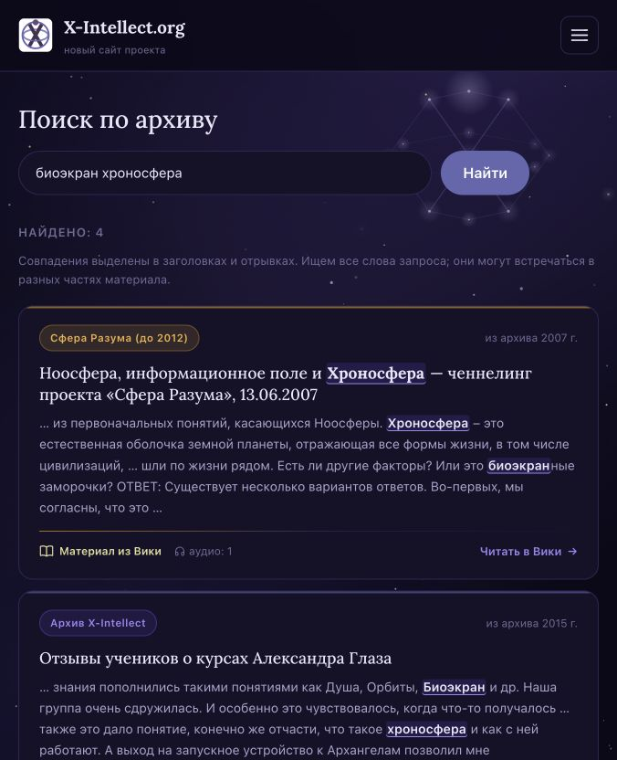

# Поиск с контекстом и подсветкой — 24.10.2026

## Что исправлено

На `/search` карточки показывали обычный анонс, независимо от места совпадения.
Поиск по исходному HTML давал ложные результаты по `class`, `href`, URL и другим
атрибутам. MySQL FULLTEXT в режиме natural language добирал материалы только
по одному из слов многословного запроса. На SQLite этот добор не работал.

## Принятый способ — повторить на другом проекте

1. Получать читаемый текст из исходного материала: убрать теги, атрибуты,
   script/style/iframe и аудиомаркеры; сохранить границы абзацев, декодировать
   HTML-сущности, нормализовать пробелы. Внутрисловную разметку не разделять:
   `био<strong>экран</strong>` остаётся словом «биоэкран».
2. Держать производное поле `pages.search_text`: заголовок + анонс + текст.
   Приводить к нижнему регистру и заменять `ё` на `е`. Заполнить существующие
   записи миграцией; обновлять поле при сохранении через `PageObserver`.
3. Искать все части запроса через AND LIKE в одном поле. Части могут встречаться
   в разных местах и в составе слов. `%`, `_` и `\` экранировать, параметры
   связывать с SQL. Ограничить строку запроса 200 символами.
4. Сортировать: фраза в заголовке → число совпавших частей в заголовке → фраза
   в тексте → дата публикации → ID. Сохранять ограничения публикации, видимости,
   архивных стенограмм и пагинацию по 20 результатов.
5. Показывать вместо анонса окно около совпадения (~240 символов). Если части
   запроса далеко друг от друга, показывать два отрывка (~150 символов каждый).
   Если совпадает только анонс, брать его; если только заголовок — обычный анонс
   или начало текста. Не обрезать слова на границах, пропуски обозначать `…`.
6. Подсвечивать фразу целиком, затем отдельные части, без учёта регистра и е/ё.
   Сначала экранировать исходный текст, только потом добавлять `<mark>`.
   Использовать ту же логику для глоссария.
7. Визуализация: `<mark class="search-match">` с цветами существующей темы
   `--xi-ink`, `--xi-accent-soft`, `--xi-accent`. Мягкий фиолетовый фон, тонкая
   акцентная линия, более плотное начертание. Под счётчиком — короткое объяснение
   подсветки и обязательности всех слов. Без дополнительного JS.
8. Проверить обе СУБД, обе темы, узкую ширину, глубокое совпадение, разнесённые
   слова, кириллицу, е/ё, сущности/теги, спецсимволы LIKE, пустую выдачу,
   пагинацию и отсутствие черновиков/служебных страниц. После деплоя повторить
   проверки на реальном контенте и сохранить снимок результата.

Это подстрочный поиск, без словаря морфологии и исправления опечаток:
«биоэкран» найдёт «биоэкрана», но произвольные изменения корня не учитываются.
Для нынешнего объёма архива LIKE подходит; на большом каталоге нужен отдельный
поисковый индекс с той же подготовкой текста и правилами выдачи.

## Файлы реализации

- `app/Support/SearchText.php` — очистка и нормализация.
- `app/Services/ArchiveSearch.php` — условия, порядок, отрывки и безопасная подсветка.
- `app/Http/Controllers/Site/SearchController.php` — материалы и глоссарий.
- `app/Observers/PageObserver.php` — актуализация поискового текста.
- `database/migrations/2026_10_24_000001_add_search_text_to_pages_table.php` —
  добавление поля и заполнение без изменения исходных текстов/дат/ревизий.
- `resources/views/site/search.blade.php`, `site/partials/page-card.blade.php`,
  `resources/css/app.css` — отображение; в остальных списках прежние карточки.
- `tests/Unit/ArchiveSearchTest.php`, `tests/Feature/ArchiveSearchTest.php` —
  12 дополнительных проверок.

При прямых SQL-изменениях заголовка/анонса/тела также пересчитывать `search_text`
через `SearchText::index()`: прямой SQL обходит наблюдатель модели.
После восстановления старого дампа запускать миграции перед использованием сайта.

## Проверки

- Полный набор на MySQL: **355 тестов, 1104 проверки**, успешно.
- Новый набор на MySQL и SQLite: **12 тестов, 41 проверка** на каждой СУБД.
- `npm run build` — успешно.
- На локальном архиве: `class` 198 → 0, `href` 145 → 0,
  «биоэкран хроносфера» 60 → 4, «БИОЭКРАН» 93 → 93.

## Проверка прода

Код выложен коммитом `d99b58d`. Перед миграцией снята полная резервная копия
базы, сохранена на сервере и локально вне Git. Поле заполнено для **341 из 341**
страниц. Контрольная сумма исходных заголовков, анонсов, тел, отрендеренных тел,
статусов, видимости и дат до/после миграции совпала.

- «биоэкран» и «БИОЭКРАН»: по **94** страницы.
- «биоэкран хроносфера»: **4** страницы; обе части видны в отрывках/заголовках.
- `class`, `href`, несуществующий запрос: **0**.
- На проверенных первых страницах выдачи каждый материал содержит подсветку.
- HTTP-проверки поиска, пустой выдачи и главной: **200**.
- Визуально проверены светлая и тёмная темы; на проде — узкая ширина 676 px.
- Запросы в проверке контроллера на сервере: **86–227 мс** (без времени сети).

Пример на проде: [биоэкран хроносфера](https://x-intellect.org/search?q=%D0%B1%D0%B8%D0%BE%D1%8D%D0%BA%D1%80%D0%B0%D0%BD%20%D1%85%D1%80%D0%BE%D0%BD%D0%BE%D1%81%D1%84%D0%B5%D1%80%D0%B0).

